# Hardware for Machine Learning: A Practical Review of Digital and Analog AI Accelerators, How to Build Them, and Where KirchhoffNet Fits

**A review paper for graduate students and researchers entering the AI-hardware field**

*Version 1.1 — August 2026 · illustrated edition (13 system-level diagrams)*

---

## Abstract

Modern artificial intelligence is, at bottom, a story about hardware. The algorithms that define deep learning — matrix multiplications wrapped in nonlinear functions — have existed for decades, but they became practically useful only when hardware could execute them fast enough and cheaply enough to matter. This review surveys the full landscape of hardware that can run machine-learning (ML) and AI models, spanning both the **digital** world (GPUs, TPUs, FPGAs, and custom digital ASICs) and the **analog and emerging** world (resistive in-memory computing, photonics, neuromorphic spiking chips, and physics-based analog networks). For each family we explain, in plain terms, *what it computes*, *how it works physically*, and *what it costs you in engineering effort and accuracy*. We then give a concrete, step-by-step account of how someone would actually design AI hardware from scratch, covering both the digital synthesis flow (RTL-to-GDSII) and the analog/mixed-signal flow (schematic, SPICE, layout, tape-out), along with the challenges that trip up newcomers. Finally, we position **KirchhoffNet** — a continuous-depth analog network governed by Kirchhoff's current law — against this landscape, examine a MOSFET-based CAD realization, and argue honestly about where it offers a genuinely novel, publishable contribution and where its claims still need to be earned in silicon.

---

## Table of Contents

1. Introduction: why AI hardware is its own discipline
2. The one operation that matters: matrix-vector multiplication
3. A taxonomy of AI hardware
4. Digital AI hardware
5. Analog and emerging AI hardware
6. How to design AI hardware from scratch
7. KirchhoffNet: a different approach
8. Head-to-head comparison
9. Open challenges and outlook
10. Conclusion
11. References

---

## 1. Introduction: why AI hardware is its own discipline

For most of computing history, "the hardware" was a general-purpose CPU, and the interesting work happened in software. Deep learning broke that arrangement. A modern neural network performs trillions of arithmetic operations for a single inference and many orders of magnitude more during training. Running these workloads on a general-purpose CPU is possible but hopelessly inefficient, because a CPU spends most of its transistors and energy on things a neural network does not need — branch prediction, out-of-order execution, deep cache hierarchies — while under-serving the one thing it does need: enormous numbers of simple multiply-and-add operations happening in parallel.

Two physical realities drive the entire field. The first is the **memory wall**. Moving a number from off-chip memory (DRAM) into a compute unit costs roughly a hundred to a thousand times more energy than the arithmetic operation that number will participate in. A 32-bit floating-point multiply might cost a few picojoules; fetching its operands from DRAM can cost hundreds of picojoules to a nanojoule. When your algorithm is dominated by billions of multiplies whose operands mostly live in memory, the memory traffic — not the arithmetic — becomes the bottleneck for both speed and energy. Almost every clever idea in AI hardware is, in some form, an attempt to avoid moving data.

The second reality is the **end of easy scaling**. For decades, Dennard scaling let each new silicon process node deliver faster, lower-power transistors "for free." That scaling has slowed dramatically. You can no longer count on the next process node to make your design twice as good; you have to earn efficiency through architecture. This is why the last decade has produced such a Cambrian explosion of specialized designs: when general-purpose scaling stalls, specialization is the only remaining lever.

This review is organized around a simple promise: for every kind of AI hardware we describe, we will tell you what it is actually computing, how the physics implements that computation, and what you give up to get its benefits. There is no free lunch anywhere in this field, and a large part of becoming competent in it is developing an intuition for the specific trade — usually accuracy, flexibility, or engineering effort — that each approach is making.

---

## 2. The one operation that matters: matrix-vector multiplication

Before surveying hardware, it is worth being precise about the workload, because nearly every design in this paper is best understood as a different physical answer to the same mathematical question.

A neural network layer, at its core, computes an **affine transform followed by a nonlinearity**:

$$
\mathbf{y} = \sigma(\mathbf{W}\mathbf{x} + \mathbf{b})
$$

Here `x` is the input vector, `W` is a matrix of learned weights, `b` is a bias vector, and `σ` is a nonlinear "activation" function such as ReLU or a sigmoid. The expensive part is `Wx` — the **matrix-vector multiplication (MVM)**, sometimes generalized to matrix-matrix multiplication (GEMM) when many inputs are processed at once. Convolutions, attention layers in transformers, and the fully-connected layers of a classifier all decompose into MVMs. If you can multiply matrices quickly and cheaply, you can run essentially any mainstream neural network quickly and cheaply.

An MVM of an *N×N* matrix by an *N*-vector requires *N²* multiply-accumulate (MAC) operations: for each output element, you multiply *N* pairs of numbers and sum them. Two facts about this operation shape all of hardware design. First, it is embarrassingly **parallel** — every one of those *N²* multiplies is independent, so hardware that can do many multiplies at once wins. Second, the weights `W` are **reused**: the same weight matrix is applied to input after input. This means that if you can keep the weights physically resident in or next to the compute units, you avoid re-fetching them from memory every cycle — directly attacking the memory wall.

Every hardware family below is, in effect, a different bet on how to exploit those two facts. Digital accelerators build large grids of arithmetic units and orchestrate data movement to keep weights reused. Analog in-memory approaches take the idea to its physical limit: they store the weights *as physical quantities* (conductances, optical phase shifts, transistor parameters) and let the laws of physics — Ohm's law and Kirchhoff's law — perform the multiply and the sum for free.

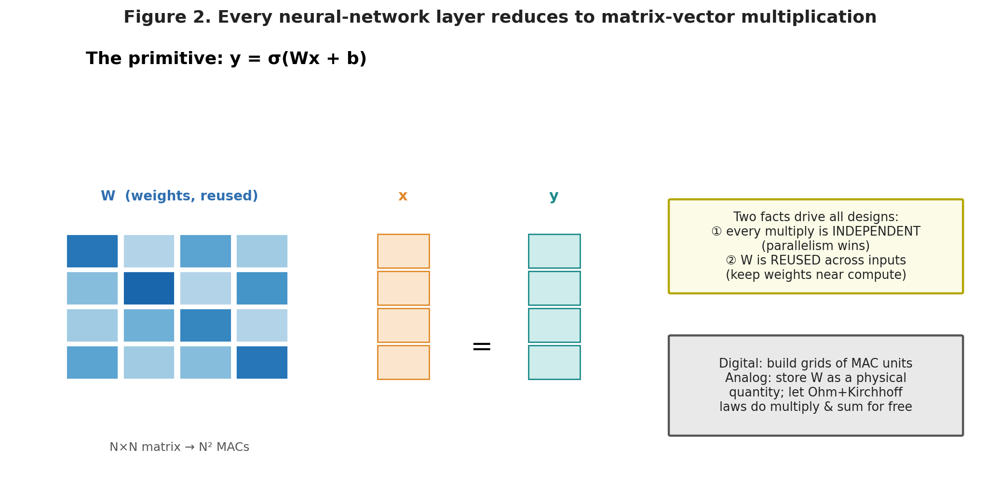{width=92%}

---

## 3. A taxonomy of AI hardware

It helps to have a mental map before diving into specifics. AI hardware can be sorted along a few independent axes.

**Digital vs. analog.** Digital hardware represents every number as a pattern of bits and computes with logic gates; it is exact, reproducible, and easy to design with mature tools, but it pays the full energy cost of moving and switching bits. Analog hardware represents numbers as continuous physical quantities — a voltage, a current, an amount of light, a resistance — and lets physics do arithmetic; it can be extraordinarily efficient but is noisy, sensitive to manufacturing variation, and hard to program precisely.

**Compute-centric vs. memory-centric (in-memory computing).** Conventional (von Neumann) designs separate memory from compute and shuttle data between them. In-memory or "compute-in-memory" (CIM) designs perform the arithmetic *inside* the memory array itself, so the weights never move. This is the single most important architectural idea in the emerging-hardware world.

**Spatial vs. temporal.** A spatial architecture lays out many physical compute units and maps the problem onto that grid (a systolic array, a crossbar). A temporal architecture reuses a smaller amount of hardware over many clock cycles. Spatial designs trade silicon area for speed and energy efficiency.

**Clocked/synchronous vs. event-driven/asynchronous.** Most hardware marches to a global clock. Neuromorphic designs instead compute only when "events" (spikes) occur, which can save enormous energy on sparse, bursty workloads but complicates programming and training.

Keep these axes in mind. When you meet a new chip, asking where it sits on each axis tells you most of what you need to know about its strengths and weaknesses.

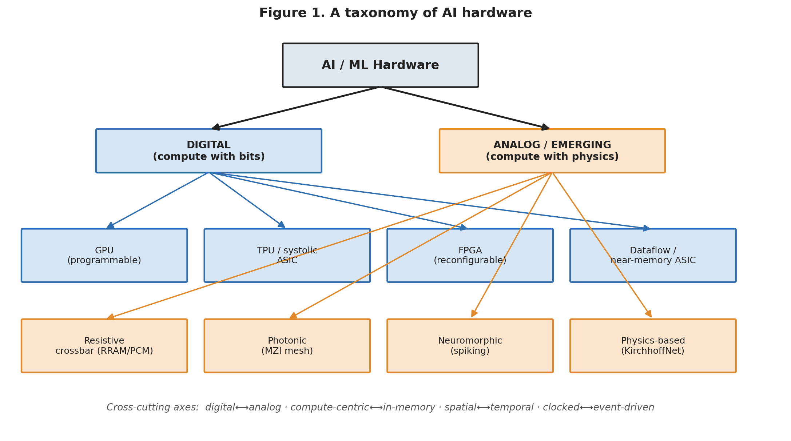{width=95%}

---

## 4. Digital AI hardware

Digital hardware runs essentially all of production AI today. Its dominance is not an accident: digital designs are exact, they compose cleanly, they benefit from a fifty-year-old ecosystem of design tools, and they scale with the semiconductor industry's manufacturing muscle. The interesting variation within the digital world is in *how much* the hardware is specialized for neural networks.

### 4.1 Graphics Processing Units (GPUs)

The GPU is the workhorse of modern AI, and it earned that role somewhat by accident. GPUs were built to render graphics, a task that also demands enormous parallel arithmetic, so they evolved into machines with thousands of small arithmetic cores operating in lockstep. When researchers realized that neural-network training is also massively parallel arithmetic, GPUs became the default.

A modern AI GPU such as NVIDIA's Blackwell **B200** is best understood as a huge collection of parallel arithmetic units fed by very fast memory. The B200 uses a **dual-die design** — two large silicon chips joined by a high-speed link and presented to software as one processor — with over 200 billion transistors, 192 GB of on-package HBM3e memory, and roughly 8 TB/s of memory bandwidth. The key AI-specific ingredient is the **Tensor Core**: a hardware block dedicated to small matrix multiplications. Rather than computing an MVM one scalar multiply at a time, a Tensor Core swallows small matrix tiles and produces a matrix product in a few cycles. Blackwell's fifth-generation Tensor Cores add native **FP4** (4-bit floating point) arithmetic with per-block "micro-scaling," which lets inference workloads trade a little numerical precision for large gains in throughput — NVIDIA quotes roughly 15× the inference performance of the previous-generation H100 for large models.

The GPU's great virtue is **flexibility**. It is fully programmable, so any new model architecture — a new attention variant, a new normalization scheme — runs on it the day it is invented. Its vices are the flip side of the same coin: because it is general, it spends energy on instruction fetch, scheduling, and data movement that a fixed-function design would avoid, and its power draw (a B200 board dissipates on the order of a kilowatt) makes it unsuitable for the edge.

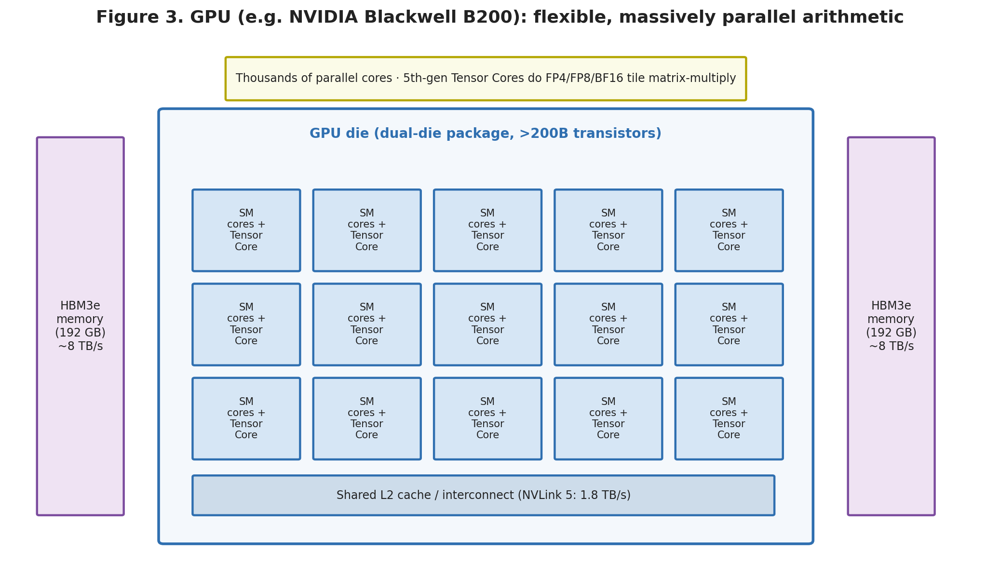{width=92%}

### 4.2 Tensor Processing Units and systolic arrays

Google's **TPU** represents the next step in specialization: a chip designed from the start to do one thing — dense matrix multiplication — extremely well. The heart of a TPU is the **systolic array**, one of the most elegant ideas in the field.

Imagine a square grid of tiny multiply-accumulate cells, say 128 rows by 128 columns. You preload the weight matrix into the grid, one weight per cell. Then you stream the input data in from the left edge, one column of the array per clock tick. Each cell multiplies the value flowing through it by its stored weight, adds the running sum arriving from the cell above, and passes both the input (to its right) and the partial sum (downward) to its neighbors on the next tick. Data flows through the array "rhythmically," like blood through a heart — hence *systolic*. After the data has rippled through, the completed dot products emerge from the bottom edge. The beauty is that once the weights are loaded, a 128×128 array performs on the order of 16,000 multiply-accumulate operations **every single clock cycle**, and crucially the weights and partial sums move only between physically adjacent cells — never back to main memory. The memory wall is defeated by construction.

Google's matrix unit (the **MXU**) was a 128×128 systolic array through the TPU v5 generation; with the **Trillium (v6e)** generation the array grew to 256×256, quadrupling the MACs per cycle. Multiplies are performed in the compact bfloat16 format while accumulation happens in higher-precision FP32 to preserve accuracy — a recurring pattern in AI hardware, where you compute in low precision but accumulate in high precision to keep errors from piling up.

The trade the TPU makes is **flexibility for efficiency**. A systolic array is spectacular at dense GEMM and comparatively awkward at anything that is not a big matrix multiply. For the workloads it targets — large-scale training and inference of mainstream networks — it delivers more performance per watt and per dollar than a GPU, which is exactly why hyperscalers build them.

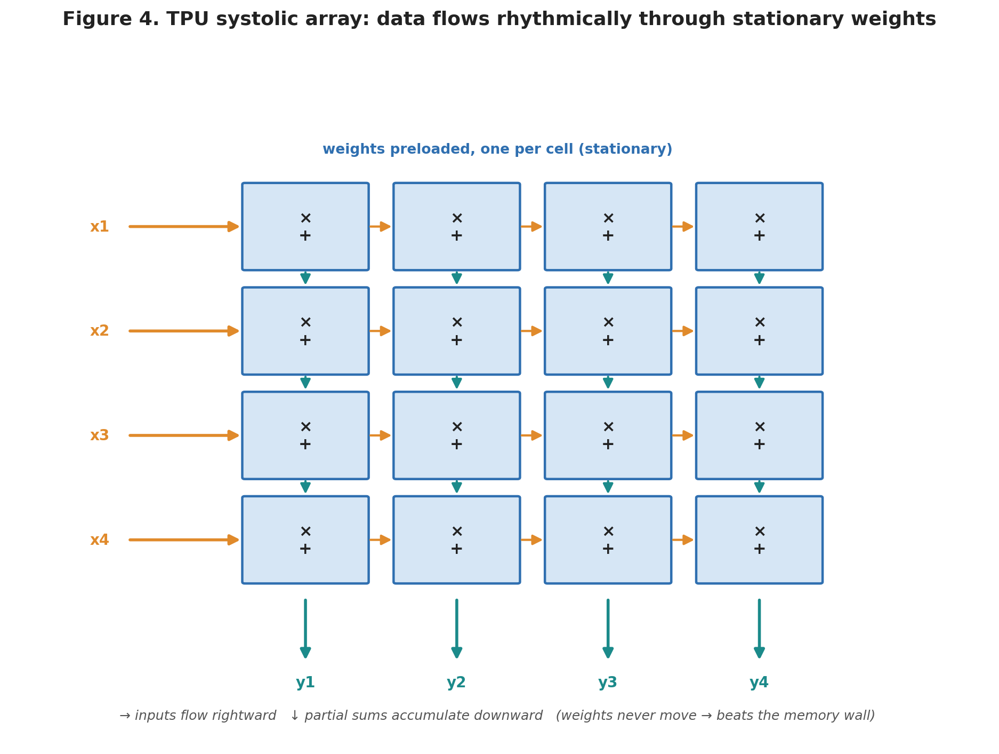{width=80%}

### 4.3 Field-Programmable Gate Arrays (FPGAs)

An FPGA sits between a general-purpose processor and a custom chip. It is a sea of configurable logic blocks, small memories, and (in modern devices) hardened DSP multiply units, connected by a programmable routing fabric. You "program" an FPGA not with software instructions but by configuring its hardware to become the exact digital circuit you want. This means you can build a bespoke neural-network accelerator — with precisely the number formats, parallelism, and dataflow your model needs — without the millions of dollars and many months required to fabricate a custom chip.

FPGAs shine in three situations: low-to-medium volume deployments where a custom chip cannot be justified, applications needing very low and deterministic latency (a fixed pipeline with no operating-system jitter), and rapidly evolving requirements where the ability to reconfigure the hardware in the field is worth a real efficiency penalty. That penalty is the catch: because an FPGA implements logic through configurable lookup tables and programmable interconnect rather than dedicated wires and gates, it is typically several times less efficient in speed, area, and power than a custom chip doing the same job. FPGAs are the prototyping ground and the mid-volume workhorse of the digital accelerator world.

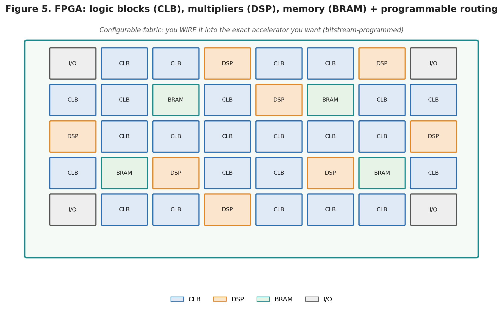{width=88%}

### 4.4 Custom digital ASICs and dataflow architectures

A custom **Application-Specific Integrated Circuit (ASIC)** is a chip designed and manufactured to run one workload. This is where a design team spends its full creativity, because every architectural choice — number format, on-chip memory size, how data flows between compute units — can be tuned to the target networks. TPUs are one example; the category also includes the many "NPUs" (neural processing units) now embedded in phones and laptops, and a wave of startup inference chips.

A particularly instructive recent example is IBM's **NorthPole**, which pushes the memory-centric idea to an extreme within a fully digital design. NorthPole eliminates off-chip weight memory entirely: all the network's weights live in memory distributed across the chip and physically interleaved with the compute units, so that no weight ever has to travel over an external bus during inference. This "compute and memory intertwined" spatial architecture, combined with aggressively low-precision arithmetic, delivers reported gains on the order of 25× in energy efficiency and 5× in silicon-area efficiency versus conventional architectures for inference tasks. NorthPole is not analog and it is not spiking — it is a reminder that a large share of the available efficiency comes simply from *not moving data*, an idea any digital designer can exploit.

The trade an ASIC makes is the harshest in the field: you exchange enormous up-front cost and total inflexibility for the best possible efficiency. A fabricated chip cannot be changed. If the dominant model architecture shifts after you tape out — as it did when transformers displaced recurrent networks — your beautifully optimized silicon may be optimized for the wrong thing. This tension between specialization and the fast-moving target of ML research is the central strategic risk of custom AI hardware.

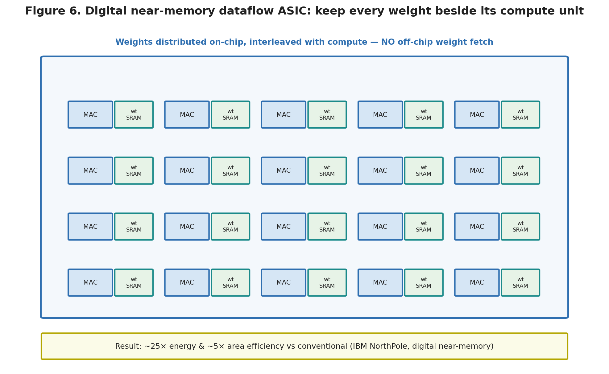{width=88%}

---

## 5. Analog and emerging AI hardware

Everything above computes with bits. The approaches in this section compute with physics. They are less mature, harder to design, and mostly still in the lab, but they attack the memory wall and the energy problem more fundamentally than any digital design can, and they are where much of the field's most interesting research now lives — including KirchhoffNet.

The unifying insight is this: **an MVM is just a large collection of multiplies followed by sums, and both operations happen for free in the right physical substrate.** Ohm's law says a current is the product of a voltage and a conductance (`I = V·G`) — that is a multiply. Kirchhoff's current law says the currents flowing into a node sum automatically — that is an accumulate. Arrange conductances in a grid, apply input voltages, and the wire currents *are* the matrix-vector product, computed in the time it takes electricity to settle, with no clocked arithmetic at all. This is the beating heart of analog in-memory computing.

### 5.1 Analog in-memory computing with resistive crossbars

Picture a grid of horizontal and vertical wires. At every crossing, place a device whose electrical conductance you can set and hold — this stored conductance is one weight of your matrix. Apply your input vector as voltages on the horizontal wires. By Ohm's law, each device passes a current equal to its conductance times its wire's voltage — a multiply. By Kirchhoff's current law, all the currents dumped onto a given vertical wire add up — an accumulate. Read the total current at the bottom of each vertical wire and you have read out one element of `Wx`. The **entire matrix-vector multiplication happens in a single physical step**, in parallel, with the weights never moving. This is the **crossbar**, and it is the canonical structure of analog CIM.

The devices at the crosspoints are the subject of intense research. The leading candidates are:

- **RRAM / memristors** (resistive RAM): two-terminal devices whose resistance can be set to analog values by growing or dissolving a conductive filament. They are small, non-volatile, fast, and CMOS-compatible. Recent RRAM macros have demonstrated energy costs on the order of tens to a few hundred femtojoules per MAC — one to two orders of magnitude better than digital — and full image-classification networks running directly on the crossbar.
- **Phase-change memory (PCM)**: stores weights in the crystalline-vs-amorphous state of a chalcogenide material; mature and reliable but with its own drift behavior.
- **SRAM-based CIM**: uses standard digital memory cells augmented to perform multiply-accumulate in or near the cell. Less exotic and fully compatible with standard fabs, at the cost of larger cells and volatility.

The promise is transformational efficiency. The problem is **non-idealities**, and they are severe enough to be the entire research frontier. Real devices do not hold exactly the conductance you program; the value drifts over time and varies from device to device. The relationship between programmed state and actual conductance is nonlinear. Analog currents pick up thermal and shot noise. And the analog result must eventually be converted back to digital by analog-to-digital converters (ADCs), which can consume a large fraction of the array's total energy and area — sometimes dominating the very budget the crossbar was trying to save. Tools such as **NeuroSim** exist specifically to model these device- and circuit-level non-idealities so designers can predict how much accuracy a real crossbar will lose relative to an idealized simulation. Bridging the gap between the beautiful physics and a manufacturable, accurate system is the central challenge, and it is far from solved.

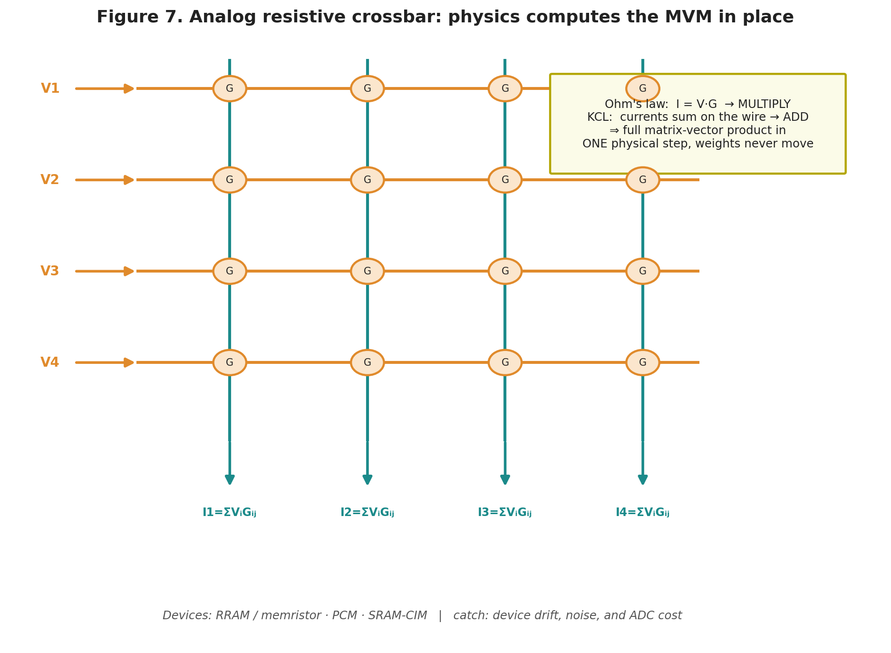{width=82%}

### 5.2 Photonic neural networks

Light is an attractive medium for computation because it is fast, it dissipates little energy while propagating, and — critically — many beams of light can pass through the same region without interfering, allowing massive parallelism and enormous bandwidth. **Photonic neural networks** encode numbers in the amplitude and phase of optical signals and perform matrix multiplication with passive optical structures.

The workhorse component is the **Mach-Zehnder interferometer (MZI)**: a device that splits a light beam into two paths, applies a controllable phase shift to one path, and recombines them so that the phase difference sets how much light emerges from each output. A mesh of many MZIs can be configured to implement an arbitrary linear transformation — a matrix multiply — on a vector of optical inputs, performed literally at the speed of light through the chip. The seminal 2017 demonstration of "deep learning with coherent nanophotonic circuits" by Shen and colleagues showed a working optical neural network on this principle, and the field has advanced rapidly: recent systems report figures such as a 262-TOPS photonic accelerator driven by an on-chip frequency-comb laser.

Photonics offers the tantalizing combination of light-speed latency and terahertz bandwidth. Its challenges are equally real: MZI meshes are physically large compared to transistors, phase shifters are sensitive to temperature and fabrication error and often need continuous calibration, converting between the electronic and optical domains at the input and output costs energy and time, and implementing the *nonlinear* activation function optically is genuinely hard — many systems still drop back into electronics for the nonlinearity. Photonics is a strong bet for the linear, high-throughput core of inference, less obviously so for a complete self-contained system.

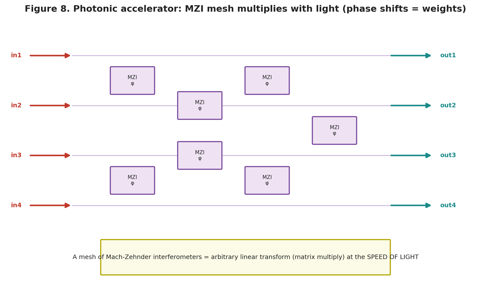{width=90%}

### 5.3 Neuromorphic and spiking hardware

Neuromorphic engineering takes its inspiration from the brain, which performs staggering computation on roughly twenty watts. The defining ideas are **event-driven computation** and **co-located memory and compute**. Instead of representing values as numbers that are continuously recomputed, spiking neural networks (SNNs) communicate with discrete **spikes** — brief events in time — and a neuron does work only when it receives or emits a spike. On sparse workloads, where most neurons are quiet most of the time, this can save enormous energy because idle hardware consumes almost nothing.

Intel's **Loihi 2** is a leading research chip in this style. It packs on the order of 120–128 asynchronous "neuro-cores" onto a chip, each simulating thousands of programmable spiking neurons with their local synaptic memory, all communicating through an on-chip mesh that routes spike events. A single Loihi 2 chip can model on the order of a million neurons; Intel's **Hala Point** system wires together 1,152 of them to reach roughly 1.15 billion neurons and 128 billion synapses, and reports solving certain optimization problems far faster and more efficiently than GPU clusters. It is worth distinguishing this from IBM's NorthPole (Section 4.4): despite frequent grouping under the "brain-inspired" banner, NorthPole is a digital, non-spiking inference engine, while Loihi 2 is a genuinely event-driven spiking processor. They borrow different lessons from biology.

The honest difficulty with neuromorphic hardware is not the silicon — it is the software and the algorithms. The mainstream deep-learning toolchain is built around dense tensors and gradient descent through differentiable layers. Spikes are discrete and not naturally differentiable, so training high-accuracy SNNs remains an active research problem, and the ecosystem is a fraction of the size of the digital one. Neuromorphic chips are genuinely excellent for sparse, event-based sensing and certain optimization tasks; they are not yet a drop-in replacement for a GPU on a standard training job.

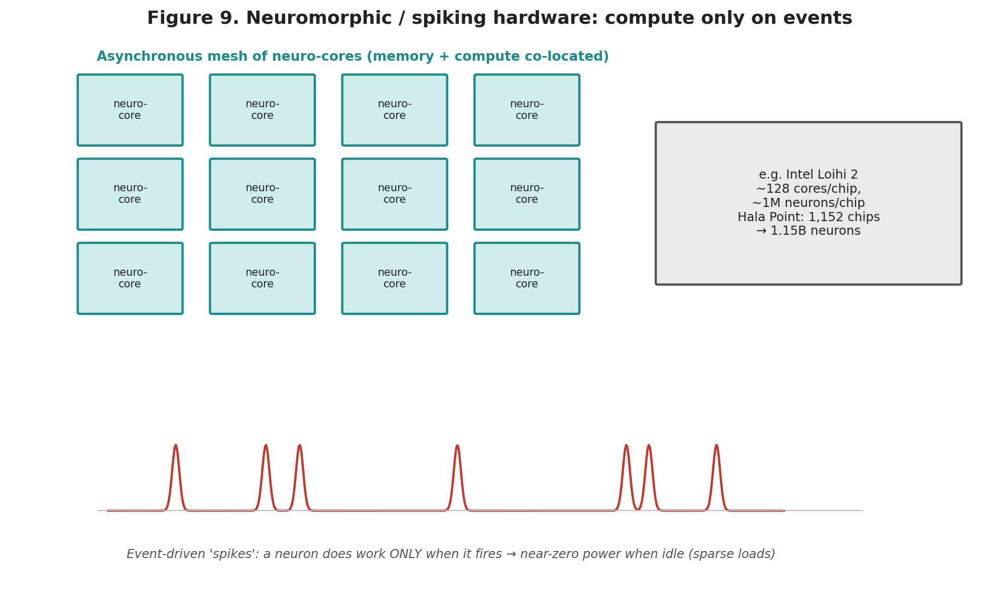{width=90%}

### 5.4 Physics-based and analog "learning" networks

There is a final, more radical branch of the analog world that does not merely *accelerate* a conventional neural network but redefines what the network *is*. In these approaches, a physical system's own dynamics — how voltages, currents, or mechanical states evolve according to physical law — *are* the computation, and "training" means adjusting physical parameters so that the system's natural evolution produces the desired input-output mapping.

Two influential threads illustrate the idea. **Equilibrium propagation** (Scellier, Bengio, and collaborators) treats an analog network as a physical system that settles into an energy-minimizing equilibrium; learning nudges the network toward equilibria that solve the task, using a training rule grounded in physics rather than conventional backpropagation. Separately, **Neural Ordinary Differential Equations** (Chen et al., 2018) reframed a deep network as a continuous-time dynamical system: instead of a fixed stack of discrete layers, the "depth" becomes a continuous time variable, and the output is obtained by integrating an ODE from the input state. Neural ODEs are trained with the **adjoint method**, an elegant technique that computes gradients by integrating a second, related ODE *backward* in time, using little memory.

These ideas matter here because they are the direct intellectual lineage of KirchhoffNet, which we turn to after first explaining how one actually builds hardware at all.

---

## 6. How to design AI hardware from scratch

This section is the practical core of the review. Suppose you have an idea for an accelerator and you want to turn it into a working chip. There are two fundamentally different design flows depending on whether your chip is digital or analog/mixed-signal. We walk through both, then discuss the cross-cutting challenges that apply regardless.

A note on realism before we start: taping out a chip in an advanced process node is a multi-million-dollar, multi-year, multi-team undertaking. Very few individuals do it end to end. But the *flow* — the sequence of steps and the tools at each — is learnable, and every step can be practiced at small scale (on an FPGA, in a SPICE simulator, or through low-cost multi-project-wafer shuttle services such as those historically offered by MOSIS and, more recently, open shuttles). Understanding the flow is what lets you reason about any hardware proposal, including your own.

### 6.1 The digital flow: from RTL to GDSII

Digital design is the more automated of the two, because logic can be described abstractly and compiled down to transistors by mature tools. The canonical sequence is:

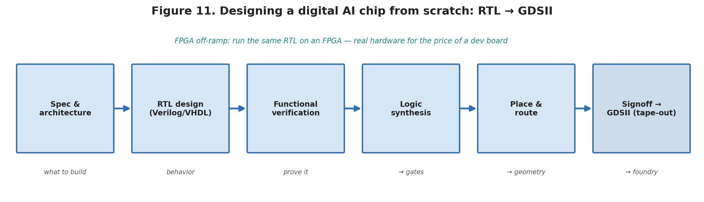{width=98%}

**Step 1 — Specification and architecture.** Decide precisely what the chip must do: which networks, what throughput, what power and area budget, what number formats. This is where you choose your architecture (systolic array? dataflow? in-memory?) and estimate, on paper or in a spreadsheet-level model, whether it can hit the targets. Mistakes here are the most expensive mistakes you can make, because everything downstream inherits them.

**Step 2 — RTL design.** Describe the hardware's behavior at the "register-transfer level" in a hardware description language (HDL) such as Verilog, SystemVerilog, or VHDL. RTL specifies what happens to data between clock edges: which registers hold what, and what combinational logic transforms them. Writing good RTL for an accelerator means expressing your dataflow — the systolic array, the accumulation, the memory buffers — in synthesizable form.

**Step 3 — Functional verification.** Prove the RTL does what you intended, using simulation testbenches, and increasingly formal methods and constrained-random verification. In industry, verification consumes more effort than design itself. A logic bug found after fabrication cannot be patched.

**Step 4 — Logic synthesis.** A synthesis tool (Synopsys Design Compiler, Cadence Genus, or the open-source Yosys) translates RTL into a **gate-level netlist**: a specific interconnection of standard cells (AND, OR, flip-flops, etc.) drawn from a foundry's standard-cell library, optimized to meet your timing, area, and power constraints.

**Step 5 — Physical design (place and route).** Now the netlist becomes geometry. Tools place every cell at physical coordinates on the die, route the wires connecting them, insert the clock distribution network, and legalize the layout against the foundry's design rules. This is where **static timing analysis** confirms that signals actually arrive within a clock period across all corners of temperature, voltage, and manufacturing variation.

**Step 6 — Signoff and tape-out.** Final checks — design-rule checking (DRC), layout-versus-schematic (LVS), power and signal-integrity analysis — culminate in a **GDSII** (or OASIS) file, the geometric database sent to the foundry. Sending it is "tape-out." Months later, wafers return.

For most people entering the field, the pragmatic on-ramp is to implement Steps 1–4 and target an **FPGA** rather than a fabricated ASIC. The same RTL that would become a chip can instead configure an FPGA, letting you validate a real hardware accelerator design for the cost of a development board rather than the cost of a mask set.

### 6.2 The analog / mixed-signal flow

Analog design — the flow relevant to crossbars, neuromorphic circuits, and KirchhoffNet — is a different world. There is no equivalent of logic synthesis; you cannot write an abstract description and have a tool generate a good analog circuit. Analog design is done largely by hand, guided by deep device physics, and verified by simulation rather than compiled from a specification. The sequence looks like this:

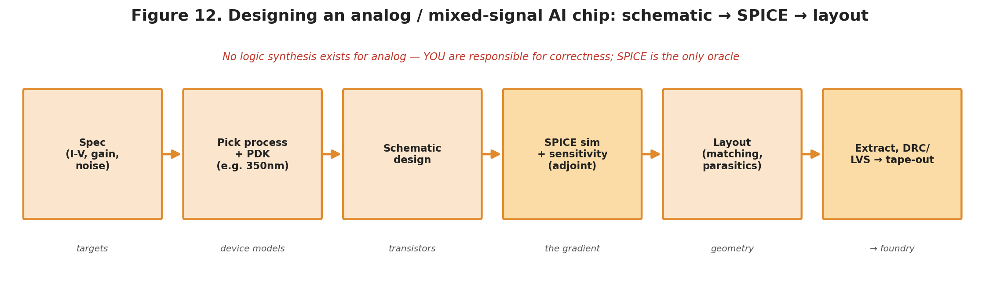{width=98%}

**Step 1 — Specification.** Translate your computational goal into electrical targets: the current-voltage relationships you need, gain, bandwidth, noise tolerance, power, supply voltage, and — for AI hardware specifically — how a "weight" is physically represented and set (a transistor's geometry or bias, a memristor's conductance).

**Step 2 — Choose a process and get the PDK.** You select a fabrication process (for research and teaching, mature nodes like a 180 nm or **350 nm** process are common and cheap) and obtain the **Process Design Kit (PDK)** — the foundry's package of device models, design rules, and standard components. The KirchhoffNet CAD work discussed later, for instance, targets a **TSMC 0.35 µm** process through a MOSIS PDK. The PDK's transistor models are what make simulation predictive of silicon.

**Step 3 — Schematic design.** Draw the circuit: the transistors, capacitors, and interconnections that implement your function. For an analog neural circuit this means designing the specific devices that realize each weight and each summing node, and the biasing that keeps every transistor in its intended operating region.

**Step 4 — SPICE simulation.** This is the analog designer's central loop. A **SPICE-class simulator** — commercial ones like Cadence Spectre, or open-source **Xyce** (from Sandia) and ngspice — numerically solves the circuit's equations to predict its behavior. You run DC operating-point analysis (does every transistor sit where you intended?), transient analysis (how do voltages evolve over time?), AC analysis, and noise analysis. You iterate on the schematic until the simulated behavior meets spec across process, voltage, and temperature corners. For a trainable analog network there is an extra, crucial ingredient: **sensitivity analysis**, computing how the outputs change with respect to each device parameter. This is the circuit-level equivalent of computing a gradient, and simulators support it through the **direct** and **adjoint** methods — the latter being far more efficient when you have many parameters and few objectives, exactly the regime of neural-network training.

**Step 5 — Layout.** Draw the physical geometry of every device and wire, respecting design rules and — uniquely to analog — a raft of subtle concerns that have no digital equivalent: matching (devices that must behave identically are drawn identically and placed symmetrically), parasitic capacitance and resistance of the wires, noise coupling, and thermal gradients. Analog layout is a craft.

**Step 6 — Extraction and post-layout verification.** Tools extract the real parasitics from the layout and you re-simulate with them included, because they can meaningfully change analog behavior. Then DRC and LVS as in the digital flow, and tape-out.

The essential mindset difference is this: in digital design the tools guarantee correctness and you optimize; in analog design *you* are responsible for correctness, the simulator is your only oracle, and small physical effects that digital designers ignore can dominate your result.

### 6.3 Cross-cutting challenges

Regardless of flow, several challenges recur across all AI hardware and deserve their own attention.

**Quantization and precision.** Neural networks are usually trained in 16- or 32-bit floating point, but hardware is far more efficient at lower precision. Deciding how few bits you can use — 8-bit integer, 4-bit float, or the analog "infinite but noisy" precision of a crossbar — without wrecking accuracy is one of the most important co-design decisions. The general finding is that inference tolerates surprisingly low precision if quantization is done carefully; training is more delicate.

**Mapping the model to the hardware.** A network described in PyTorch must be partitioned, scheduled, and mapped onto whatever physical resources exist — a compiler problem that is often harder than the hardware design. A chip is only as good as the software stack that can target it, which is a large part of why GPUs, with their mature software, remain dominant even where specialized hardware is nominally more efficient.

**Non-idealities and variation.** Especially in analog, real devices deviate from their models: they vary across the die, drift over time, and respond to temperature. A design that works in simulation under nominal conditions can fail across the manufacturing spread. Robust designs either tolerate this variation architecturally or calibrate it out — both of which cost something.

**Verification and the cost of being wrong.** Because a fabricated chip cannot be patched, the penalty for an escaped bug is a re-spin costing months and millions. This is why verification dominates schedules and why simulation fidelity is treated as sacred.

**The moving target.** Perhaps the deepest challenge is strategic rather than technical: ML research moves faster than silicon. A chip specialized for today's dominant architecture may meet a different world when it ships. The most successful designs hedge by accelerating a *primitive* (the MVM) that is likely to remain central, rather than a specific model.

### 6.4 Summary of the design challenge

The table below condenses the two flows and where their difficulty concentrates.

| Aspect | Digital flow | Analog / mixed-signal flow |
|---|---|---|
| Primary description | RTL (Verilog/VHDL) | Schematic of devices |
| Correctness comes from | Automated synthesis + verification | Human design + SPICE simulation |
| Key tools | Synthesis, place-and-route, STA, DRC/LVS | SPICE (Spectre, Xyce, ngspice), layout, extraction |
| "Gradient" analog | N/A | Sensitivity analysis (direct / adjoint) |
| Dominant difficulty | Verification effort, timing closure | Device non-idealities, matching, noise |
| Cheap practice path | FPGA prototyping | SPICE + low-cost MPW shuttle |
| Cost of a bug | Re-spin (huge) | Re-spin (huge) |

---

## 7. KirchhoffNet: a different approach

We now have the context to place KirchhoffNet precisely. It belongs to the physics-based analog family of Section 5.4, it is built and validated through the analog flow of Section 6.2, and it makes a claim about the memory wall and scaling that is genuinely different from everything above. We describe what it is, the mathematics that makes it work, the CAD realization being explored, and — in keeping with a reviewer's duty — where it is strong and where its promises remain unproven.

### 7.1 The core idea

Most analog AI hardware, including the crossbars of Section 5.1, uses physics to accelerate a computation that was *conceived* as a conventional layered neural network: you still think in terms of `Wx + b`, you just execute the MVM in the analog domain. **KirchhoffNet**, introduced by Zhengqi Gao, Fan-Keng Sun, Ron Rohrer, and Duane Boning at MIT (ICCAD 2024), takes a more radical stance. It has *no layers at all* — no convolution, no attention, not even a linear layer. Instead, the neural network **is** an analog circuit, and the computation is the circuit's natural time evolution under **Kirchhoff's current law (KCL)**.

The picture is this. Take a circuit described as a graph of nodes connected by devices. Each node has a voltage. The input to the network is the set of node voltages at time *t = 0*; the output is the set of node voltages at a later time *t = 1*. In between, the voltages evolve continuously according to the currents flowing through the devices, exactly as any real circuit does. The learnable parameters are the properties of the devices on the edges. Training the network means choosing those device parameters so that the circuit, starting from an input encoded as initial voltages, evolves to an output that solves your task. Remarkably, the authors show that even with this stripped-down formulation — no classical layers whatsoever — a KirchhoffNet reaches **98.86% test accuracy on MNIST**, comparable to conventional convolutional networks.

### 7.2 The mathematics, in plain terms

The formal content is worth understanding because it is what makes the approach both elegant and unusual.

Kirchhoff's current law states that at every node, the currents flowing in equal the currents flowing out — charge is conserved. If each node also connects to ground through a fixed unit capacitor, then KCL at node *j* becomes a statement about how fast that node's voltage changes:

$$
\dot{v}_j = \sum_{s} g(v_s, v_j, \boldsymbol{\theta}_{sj}) - \sum_{d} g(v_j, v_d, \boldsymbol{\theta}_{jd})
$$

In words: the rate of change of a node's voltage equals the net current delivered to it by all its connected devices, and each device's current is a learnable nonlinear function *g* of the voltages at its two ends and its parameters `θ`. Written for all nodes at once, this is simply

$$
\dot{\mathbf{v}} = f(\mathbf{v}, \boldsymbol{\theta})
$$

which is exactly the form of a **Neural ODE**. This is the key conceptual bridge: *a circuit governed by KCL is literally a continuous-depth neural network*, with physical time playing the role of network depth. The authors' chosen device nonlinearity is a rectifying element, `g = θ₁ · ReLU(vₛ − v_d − θ₂)`, which corresponds physically to a conductance and current source gated by a one-sided switch — a shape that standard MOS transistors can approximate.

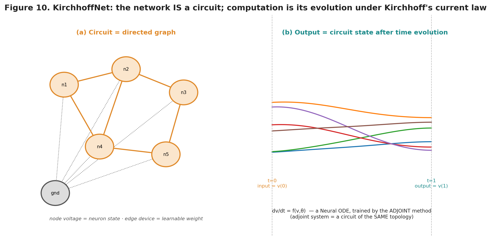{width=98%}

Two consequences follow, and they are the intellectual payoff.

First, **training**. Because the model is a Neural ODE, it can be trained with the **adjoint method**: run the circuit forward in time to get the output, then integrate an "adjoint" system backward in time to obtain the gradient of the loss with respect to every device parameter. The authors prove something particularly striking here — the adjoint system of a KirchhoffNet is *itself a circuit with the same topology as the original*, in which the nonlinear devices are replaced by simple conductances set by the forward solution. In other words, the gradient computation is another circuit simulation of the same shape as the forward pass. This is the circuit-design analog of backpropagation, and it connects directly to the sensitivity-analysis machinery (direct/adjoint) that SPICE-class simulators already provide.

Second, and most provocatively, **scaling**. The forward computation is "run the circuit from *t = 0* to *t = 1*." How long that takes in wall-clock time depends only on the capacitance and the timescale you choose, *not* on how many parameters the circuit has. Rescale time and capacitance together — use picofarad capacitors instead of farads — and the same evolution completes in nanoseconds. The authors argue that a physically realized KirchhoffNet completes one forward pass in roughly **1/f seconds**, where *f* is the clock frequency, **regardless of the number of parameters** in the network. A conventional accelerator's inference time grows with the size of the network; a KirchhoffNet's, in principle, does not. That is the headline claim, and it is what would make the approach matter if it holds up.

### 7.3 The CAD realization

Translating this mathematics into silicon is the work reflected in the referenced CAD project (`toy2d_serial_diff` within the `kirchoff_claude` effort). The design context, drawn from the project's own records, is a **neuromorphic circuit design and simulation** effort targeting a **TSMC 0.35 µm** process via a **MOSIS PDK**, working with MOSFET-based building blocks organized in **ring topologies**. Concretely, the circuit variants include a summing-node topology built from NMOS transistors (a four-NMOS summing node in the `kirchoffnet_exp` variant) and multi-stage differential-amplifier rings — physical embodiments of the nodes and nonlinear edge devices the theory calls for. The summing node is exactly where KCL does its work: currents from several transistor "edge" devices meet and add.

The training-relevant part of the CAD flow is **sensitivity analysis via the adjoint method**, implemented in the open-source **Xyce** simulator. In practice this means computing the sensitivity of a drain-source voltage with respect to a gate voltage — the derivative of an output with respect to a controllable device parameter — which is precisely the per-parameter gradient the adjoint theory promises. The workflow settled on Xyce with `direct=0 adjoint=1` for single-objective sensitivity after earlier Spectre/OCEAN-based finite-difference approaches proved unproductive; the design records note the practical constraints that shaped this (Xyce's transient adjoint accepting only a single objective function, the need for explicit DC supply rails to avoid degenerate operating points, and the mandatory `objfunc=` directive). This is the analog flow of Section 6.2 applied faithfully to a trainable circuit: schematic, SPICE simulation, adjoint sensitivity as the gradient, iterate.

*A caveat on scope:* this description is assembled from the project's design notes rather than from the current source files themselves, which were not accessible in this session. The specific `toy2d_serial_diff` scripts — a two-dimensional toy problem run through the serial differential-ring circuit, by the name — would let this section report exact topologies, parameter counts, and measured sensitivities. Connecting that directory would let those specifics be folded in and would materially strengthen a submission's experimental section.

### 7.4 How KirchhoffNet differs from the rest of the field

It is easy to lump KirchhoffNet in with "analog AI hardware" generally, but the differences are precisely what make it publishable, so they are worth stating sharply.

Against **digital accelerators (GPU/TPU/ASIC)**, the difference is total: those decompose a network into MVMs and schedule them onto arithmetic units; KirchhoffNet does not perform explicit MVMs at all — there is no weight matrix being multiplied, only a circuit relaxing to equilibrium.

Against **analog crossbars (RRAM/PCM)**, the difference is subtle but real. A crossbar is still computing `Wx`: it accelerates the *same layered computation* a digital chip would, using Ohm's and Kirchhoff's laws to do the multiply-accumulate in place. KirchhoffNet uses Kirchhoff's law not to implement a matrix multiply but to define the *entire model* as a continuous dynamical system. A crossbar is a fast layer; KirchhoffNet is a layer-free network. Consequently KirchhoffNet does not obviously need the power-hungry per-column ADCs that dominate crossbar energy budgets, though it introduces its own readout and encoding problems.

Against **other physics-based networks (equilibrium propagation)**, the difference is the one the authors themselves emphasize: equilibrium-propagation networks are defined by an energy function and settle to a static equilibrium, trained by nudging that equilibrium. KirchhoffNet is explicitly *time-domain and dynamical* — it introduces capacitance, evolves in time, and is trained by the adjoint method borrowed from Neural ODEs. It is the marriage of continuous-depth deep learning with literal circuit dynamics that is new.

Against **conventional Neural ODEs**, finally, the twist is that in a standard Neural ODE the function *f* driving the dynamics is itself an ordinary deep network run on a GPU — the "continuous depth" is a mathematical abstraction executed digitally. In KirchhoffNet, *f* is not a network to be evaluated; it is the physics of a circuit that computes itself. The abstraction becomes the hardware.

The following table summarizes the positioning.

| Approach | What computes the model | Weights stored as | Explicit MVM? | Time per forward pass | Maturity |
|---|---|---|---|---|---|
| GPU (Blackwell) | Programmable arithmetic cores | Digital, in DRAM/SRAM | Yes | Grows with network size | Production |
| TPU systolic array | Grid of MAC cells | Digital, loaded into array | Yes | Grows with network size | Production |
| RRAM/PCM crossbar | Ohm + KCL in memory array | Analog device conductances | Yes (in place) | ~Constant per layer; ADC-bound | Lab / early product |
| Photonic MZI mesh | Optical interference | Optical phase shifts | Yes | Light-speed; E/O conversion cost | Lab |
| Neuromorphic (Loihi 2) | Event-driven spiking cores | Digital synapses | No (spike-based) | Workload-dependent | Research |
| Equilibrium-prop network | Energy minimization to equilibrium | Analog parameters | No | Settling time | Research |
| **KirchhoffNet** | **Circuit ODE evolution under KCL** | **Device parameters on edges** | **No — no layers at all** | **~1/f, claimed independent of parameter count** | **Early research / CAD** |

### 7.5 Why it is publishable — and where to be skeptical

In keeping with the duty to stress-test rather than celebrate, here is the honest assessment.

**The genuinely novel, defensible contributions** are three. First, the *conceptual identity* it establishes — that a KCL-governed circuit is exactly a continuous-depth message-passing network — is a clean and non-obvious bridge between circuit theory and modern deep learning, and the proof that the adjoint system is itself a same-topology circuit is a real theoretical result with practical teeth. Second, the *parameter-count-independent forward-time* argument, if realized, attacks a scaling limit that no digital accelerator can escape; even as a well-argued possibility it is the kind of claim that reframes how people think about analog inference. Third, and most concretely for the referenced work, a *worked CAD path* — MOSFET summing nodes in a real 350 nm PDK, trained by adjoint sensitivity in Xyce — moves the idea from a software abstraction toward physical plausibility, which is exactly the contribution the original paper flagged as future work ("substantial engineering and exploration of approximate implementations using standard MOS transistors will be needed").

**Where a reviewer will push, and rightly:**

- *The 1/f claim hides real costs.* Forward-pass time may be independent of parameter count, but **programming** the parameters, **loading** the input voltages, and **reading out** the output voltages are not free, and at nanosecond timescales the measurement problem the authors themselves flag ("measuring nodal voltages at the picosecond timescale may be challenging") could dominate. The scaling advantage must be demonstrated against *end-to-end* latency and energy, not just the settling time of the core.
- *MNIST is not evidence of scalability.* 98.86% on MNIST is a proof of concept, not a demonstration that the approach scales to the large, hard problems where it would need to win. The result is promising precisely because it uses no classical layers, but MNIST is solvable by almost anything.
- *Analog non-idealities are unaddressed at the demonstrated level.* Everything in Section 5.1 that plagues crossbars — device variation, drift, noise, temperature sensitivity, the gap between the idealized nonlinearity `g` and what a real transistor delivers — applies here too. A software simulation of the ODE is not subject to these; a fabricated circuit is. The value of the CAD work is precisely that it can begin to quantify this gap, which is why grounding the paper in measured or SPICE-extracted (not idealized) behavior is the single highest-leverage way to strengthen it.
- *Training a physical instance is unsolved.* The adjoint-as-circuit result is beautiful, but training presently happens in simulation; whether device parameters can be programmed to their trained values with sufficient precision, and whether in-situ training on the physical circuit is feasible, are open.

The through-line is that KirchhoffNet's *ideas* are strong and its *positioning* is genuinely distinct — it is neither a crossbar nor a spiking chip nor a digital ODE solver — but its *claims* are, as of now, largely established in software and theory. The most publishable version of this work is one that closes the loop to physics: report the CAD circuit's behavior including non-idealities, quantify end-to-end (not core-only) latency and energy, and show the approach holding up on at least one task harder than MNIST. That is a demanding bar, but it is the bar that separates a provocative idea from a hardware result the field will build on.

---

## 8. Head-to-head comparison

Pulling the whole survey together, the table below compares the families on the axes that matter to a practitioner deciding what to build or study. Ratings are qualitative and relative.

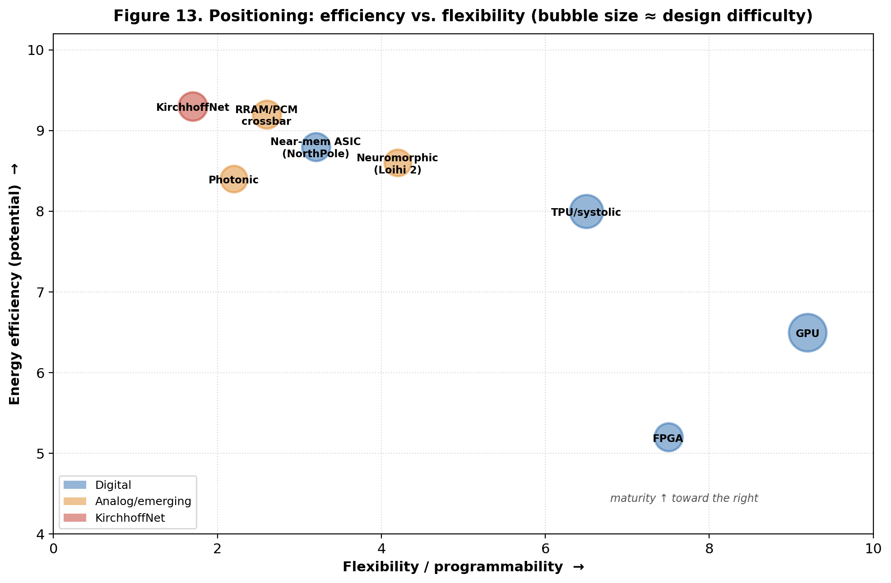{width=85%}

| Family | Energy efficiency | Flexibility | Maturity / ecosystem | Design difficulty | Best-suited role |
|---|---|---|---|---|---|
| GPU | Low–moderate | Very high | Highest | Moderate (use existing chips) | Training and general inference |
| TPU / systolic ASIC | High | Moderate | High | Very high (custom silicon) | Large-scale dense workloads |
| FPGA | Moderate | High (reconfigurable) | High | Moderate–high | Prototyping, low latency, mid-volume |
| Digital dataflow ASIC (e.g. NorthPole) | Very high | Low | Emerging | Very high | Fixed-model edge/datacenter inference |
| RRAM/PCM analog crossbar | Very high (core); ADC-limited | Low–moderate | Emerging | Very high (device + circuit) | In-memory inference of fixed models |
| Photonic | Potentially very high | Low | Early research | Very high (photonics + electronics) | High-throughput linear inference |
| Neuromorphic / spiking | Very high on sparse loads | Moderate | Research | High | Event-based sensing, optimization |
| Physics-based / KirchhoffNet | Potentially very high | Unproven | Early research | Very high (analog + ML co-design) | Continuous-depth inference, research frontier |

The pattern to internalize is that efficiency and flexibility trade against each other, and maturity tracks flexibility. GPUs win on flexibility and ecosystem; the analog and emerging approaches win, in principle, on efficiency but pay in design difficulty, immaturity, and accuracy risk. There is no universally best answer — only the best answer for a given workload, volume, and tolerance for engineering risk.

---

## 9. Open challenges and outlook

Several themes cut across the entire field and are worth watching.

The **memory wall remains the organizing problem**. Whether the answer is keeping weights in a systolic array, distributing them across a NorthPole-style die, storing them as conductances in a crossbar, or dissolving them into circuit dynamics as KirchhoffNet does, the winning ideas are the ones that move the least data. Any new proposal should be evaluated first on this axis.

**Analog's accuracy gap is the central unsolved problem** for the emerging families. The physics gives enormous efficiency; the non-idealities take back an uncertain fraction of it. Progress here — better devices, better calibration, architectures and training methods that are robust to variation, and honest simulation tools like NeuroSim — will determine whether analog computing graduates from the lab.

**Software and mapping decide adoption.** The history of the field shows repeatedly that the most efficient hardware does not win; the most *usable* hardware wins. A design without a compiler and a path from PyTorch is a physics demonstration, not a product. This is as true for KirchhoffNet as for a crossbar.

**Co-design is the frontier.** The most interesting recent work refuses to separate the model from the hardware. KirchhoffNet is a pure example: the network and the circuit are the same object, designed together. Expect more of this — algorithms shaped to physics, and physics shaped to algorithms — and expect the people who can work fluently on both sides of that boundary to do the most valuable work.

---

## 10. Conclusion

AI hardware is a field defined by a single relentless pressure — the cost of moving and computing on numbers — and by the many ingenious physical answers engineers have devised in response. The digital mainstream (GPUs, TPUs, FPGAs, and custom ASICs) offers exactness, maturity, and a deep software ecosystem, and it will run essentially all production AI for the foreseeable future. The analog and emerging families (resistive crossbars, photonics, neuromorphic chips, and physics-based networks) offer a more fundamental assault on the energy and memory limits, at the price of accuracy risk and formidable design difficulty. Designing any of it from scratch means mastering one of two flows — the automated digital path from RTL to GDSII, or the hand-crafted, simulation-driven analog path — and confronting the same hard truths about verification, quantization, non-idealities, and the fast-moving target of ML research.

Against this backdrop, KirchhoffNet is a genuinely distinctive idea. It does not accelerate a conventional network; it redefines the network as the time-domain behavior of a circuit governed by Kirchhoff's current law, trained by an adjoint method that turns out to be another circuit of the same shape. Its promise — inference time independent of parameter count — is exactly the kind of claim that could matter, and a CAD realization in a real MOSFET process moves it from abstraction toward silicon. Whether it becomes more than a beautiful idea depends on closing the loop to physical reality: demonstrating end-to-end efficiency, tolerating analog non-idealities, and scaling past toy problems. That is a hard road, but it is a *different* road from everyone else's, and in a field crowded with variations on the systolic array, a genuinely different road is the rarest and most publishable thing there is.

---

## 11. References

1. Z. Gao, F.-K. Sun, R. Rohrer, D. S. Boning. *KirchhoffNet: A Scalable Ultra Fast Analog Neural Network.* ICCAD 2024. arXiv:2310.15872. https://arxiv.org/abs/2310.15872
2. KirchhoffNet source code. https://github.com/zhengqigao/kirchhoffnet
3. R. T. Q. Chen, Y. Rubanova, J. Bettencourt, D. Duvenaud. *Neural Ordinary Differential Equations.* NeurIPS 2018.
4. B. Scellier. *A Deep Learning Theory for Neural Networks Grounded in Physics.* arXiv:2103.09985, 2021.
5. J. Kendall, R. Pantone, K. Manickavasagam, Y. Bengio, B. Scellier. *Training End-to-End Analog Neural Networks with Equilibrium Propagation.* 2020.
6. Y. Shen et al. *Deep Learning with Coherent Nanophotonic Circuits.* Nature Photonics 11, 441–446, 2017.
7. Google Cloud. *TPU System Architecture.* https://docs.cloud.google.com/tpu/docs/system-architecture-tpu-vm
8. NVIDIA. *Blackwell Architecture.* https://www.nvidia.com/en-us/data-center/technologies/blackwell-architecture/
9. Intel. *Loihi 2 / Hala Point neuromorphic system.* (Intel Labs, 2024).
10. D. Modha et al. *NorthPole: Neural inference at the frontier of energy, space, and time.* Science, 2023.
11. Shooshtari et al. *Review of Memristors for In-Memory Computing and Spiking Neural Networks.* Advanced Intelligent Systems, 2026.
12. *Strategies of high-accuracy memristor-based analogue computing in memory for AI.* Nature Materials, 2026.
13. *NeuroSim V1.5: Benchmarking Compute-in-Memory Accelerators with Device and Circuit-level Non-idealities.* arXiv:2505.02314.
14. *A 262 TOPS hyperdimensional photonic AI accelerator powered by a Si3N4 microcomb laser.* APL Photonics, 2025.
15. Sandia National Laboratories. *Xyce Parallel Electronic Simulator* (open-source SPICE-class simulator with direct/adjoint sensitivity).

---

*Prepared as a graduate-level review. The KirchhoffNet CAD details are characterized from the project's design records; connecting the source directory (`toy2d_serial_diff`) would allow exact topologies, parameter counts, and measured sensitivities to be incorporated.*
