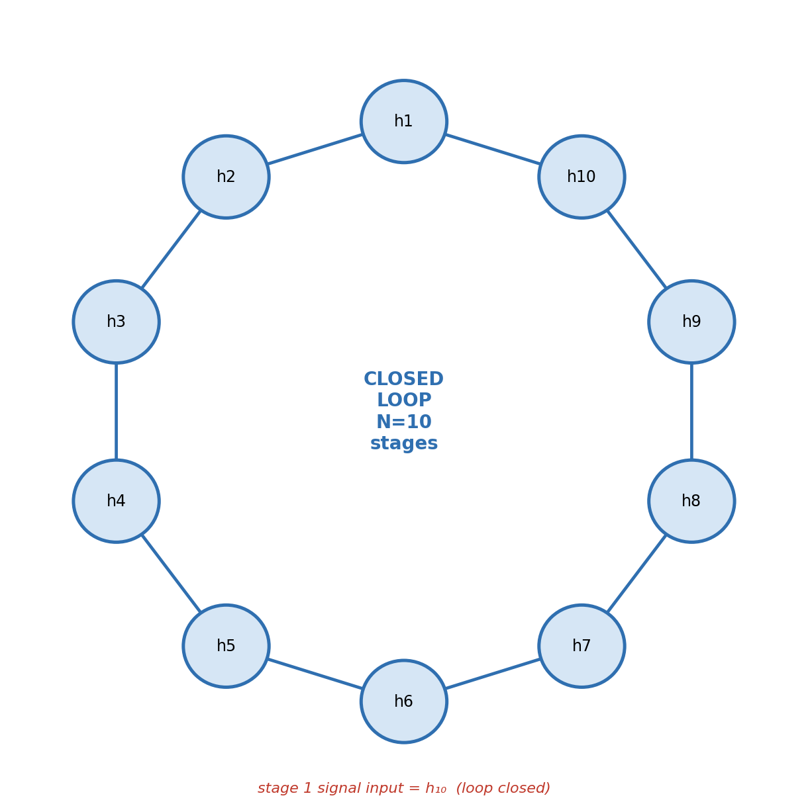
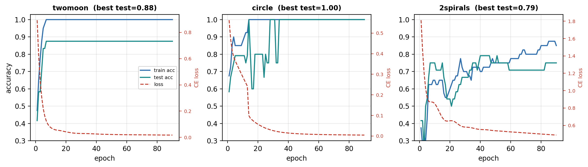
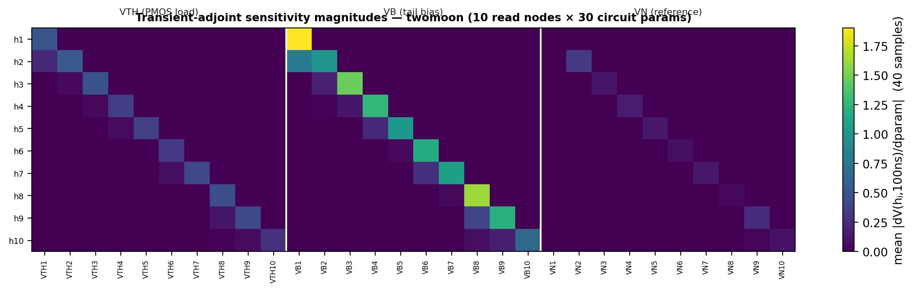
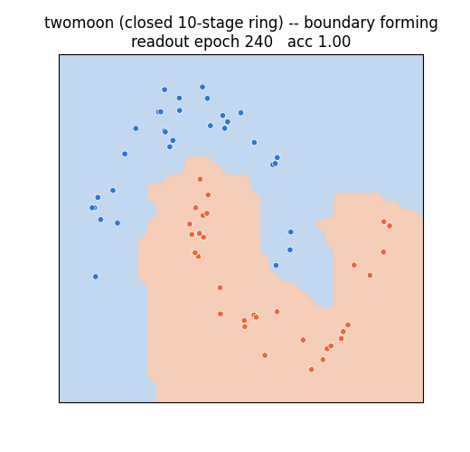

# I. Introduction

The energy cost of contemporary machine learning is dominated not by arithmetic but by the movement of data between memory and compute [1], [2]. This observation motivates a broad research program in *in-memory* and *analog* computing, in which the physical laws of a device perform arithmetic in place, avoiding data movement entirely [3]–[6]. Within this program, a recent and conceptually distinct proposal is **KirchhoffNet** [7], which does not merely accelerate a conventional layered network in the analog domain but redefines the network itself as an analog circuit: the node voltages are the neuron states, the devices on the edges are the learnable parameters, and the computation is the circuit's natural time evolution under Kirchhoff's current law (KCL). Gao *et al.* [7] proved that a KCL-governed circuit with capacitive storage is formally a continuous-depth, or Neural-ODE [8], model, that it can be trained by the adjoint method, and — strikingly — that the adjoint system is itself a circuit of the same topology. They demonstrated 98.86% accuracy on MNIST in a *software* realization using idealized device current–voltage laws, and explicitly flagged that "substantial engineering and exploration of approximate implementations (e.g., using standard MOS transistors) will be needed" to move toward silicon.

This paper addresses precisely that flagged gap, at small scale and with full transparency about what is and is not achieved. We construct a concrete CMOS circuit — a **closed-loop ring of ten differential-amplifier stages** — and train its physical bias parameters *through a real circuit simulator*, using the simulator's backward transient-adjoint sensitivities as the gradient signal rather than an idealized analytic model. Three properties make the construction faithful to the KirchhoffNet idea in a way that a purely software model is not:

1. **Input as initial state.** The data point is injected exclusively as initial conditions (`.IC`) on the ring's storage-node voltages at *t* = 0. There are no separate input-voltage sources driving gates during evolution; data enters only through the seeded state, exactly the "input = initial state" premise of a Neural ODE [8].
2. **Closed-loop nonlinear dynamics.** The ten stages are connected in series and the loop is closed (stage 1's signal input is stage 10's output), so the seeded state evolves under genuinely coupled nonlinear feedback for a fixed 100 ns before read-out.
3. **Hardware-derived gradients.** The thirty per-stage parameters are trained through the simulator's 100 ns backward transient adjoint, i.e., through the same class of sensitivity computation that a physical or SPICE-accurate system would provide, not through a differentiable software surrogate.

Our contribution is deliberately scoped. We do **not** claim competitive accuracy on hard tasks, nor a fabricated chip, nor an energy measurement. We claim (i) a working demonstration that the physical parameters of a *closed* analog ring can be trained end-to-end through a transient adjoint; (ii) a stable training recipe whose acceptance criterion guards operating-point convergence, which we show is necessary to avoid a specific and easily-missed degeneracy; and (iii) an honest, ablation-supported accounting of where the classification accuracy actually originates. Section VIII is candid that a co-trained linear read-out, not the circuit, supplies most of the accuracy — a point we consider essential to report rather than obscure.

# II. Background and Related Work

## A. From Neural ODEs to circuit dynamics

A Neural ODE [8] replaces the discrete layers of a deep network with a continuous-time dynamical system $\dot{\mathbf{v}} = f(\mathbf{v}, t, \boldsymbol{\theta})$, in which the input is the initial state $\mathbf{v}(0)$ and the output is the state $\mathbf{v}(T)$ obtained by integrating to time $T$. Gradients are obtained with the *adjoint method*, integrating a second ODE backward in time with constant memory. KirchhoffNet [7] observes that a physical circuit in which every node has a capacitance to ground and is driven by current-mode devices obeys, by KCL,
$$
C_j \frac{dV_j}{dt} = \sum_{k \in \mathcal{N}(j)} i_{kj}(V_k, V_j, \boldsymbol{\theta}_{kj}),
\tag{1}
$$
which is exactly of Neural-ODE form with $\mathbf{v} \equiv \mathbf{V}$. The learnable parameters live in the device current laws $i_{kj}$. This is the formal bridge our circuit instantiates in silicon-realistic form.

## B. Analog and in-memory neural hardware

Analog crossbars based on resistive RAM or phase-change memory perform matrix–vector products through Ohm's law and KCL [3]–[5], and remain the most commercially advanced analog approach, though device non-idealities and data-converter overhead bound their accuracy. Photonic meshes multiply with light [6]. Neuromorphic processors such as TrueNorth [9] and Loihi [10] compute with spikes, while NorthPole [11] shows that a purely digital, near-memory design captures much of the available efficiency. Physics-based *learning* networks — equilibrium propagation [12] and KirchhoffNet [7] — differ from all of these in that the physical system's own dynamics constitute the model. Our work sits in this last category and is, to our knowledge, among the first to train a *closed-loop, SPICE-simulated transistor* ring of this kind through a transient adjoint.

## C. Adjoint sensitivity in circuit simulation

The adjoint method for computing the sensitivity of a circuit output to its parameters is classical in the electronic-design-automation literature and predates its rediscovery in machine learning; it is the standard efficient route to $\partial(\text{output})/\partial(\text{many parameters})$ in SPICE-class simulators [13], [14]. Our simulator returns, from a single transient solve with `sensitivity=True`, both the read-node voltages at 100 ns and the backward transient-adjoint sensitivities $\partial V(h_j, 100\,\text{ns})/\partial p$ for every requested source parameter $p$. This is the gradient signal we train on.

# III. Circuit Architecture

## A. One differential-amplifier stage

Each stage is a textbook analog "neuron": an NMOS differential pair with a PMOS active load and an NMOS tail current source, shown in Fig. 2. For stage $j$, the signal-branch transistor's gate is driven by the **previous** stage's output $h_{j-1}$; the dummy branch's gate is a per-stage trainable reference $\text{VN}_j$; the PMOS loads share a per-stage trainable bias $\text{VTH}_j$; and the tail transistor's gate is a per-stage trainable bias $\text{VB}_j$. The output node $h_j$ carries a 1 pF storage capacitance and is the state variable of the stage. Devices use Level-1 (Shichman–Hodges) models with sizes identical to the simulator's committed reference example, giving three trainable parameters per stage.

{width=62%}

## B. The closed ring

The ten stages are wired in series, output to signal input, and the loop is closed by feeding stage 10's output $h_{10}$ into stage 1's signal input (Fig. 3). The resulting system has ten state nodes $h_1,\dots,h_{10}$ and $3N = 30$ trainable parameters. With per-node capacitance $C_j = 1\,\text{pF}$, the ring obeys the coupled system
$$
C_j \frac{dV(h_j)}{dt} = I_{\text{load}}\!\big(V(h_j), \text{VTH}_j\big) - I_{\text{sig}}\!\big(V(h_{j-1}), V(h_j), \text{VB}_j, \text{VN}_j\big),
\tag{2}
$$
with indices taken modulo $N$ so that $h_0 \equiv h_{10}$. Equation (2) is a *lumped* representation of the net current charging node $h_j$: $I_{\text{load}}$ is the PMOS active-load current delivered to the output node and $I_{\text{sig}}$ the current drawn by the signal-branch NMOS, whose split is set by the differential pair biased by the tail source; the simulator solves the exact device equations, and (2) is written only to expose the Neural-ODE structure. It is the concrete, transistor-level instance of the abstract KirchhoffNet dynamics (1). Closing the loop is what turns the circuit from a feed-forward chain into a genuine dynamical system whose read-out state depends nonlinearly on the entire seeded input.

{width=42%}

# IV. Input Encoding and Read-Out

By design, all learning capacity is placed in the circuit and in a single linear read-out; the pre- and post-processing are intentionally minimal so that any nonlinear separating power can be attributed to the ring rather than to a deep software wrapper (Fig. 1).

**Encoder (fixed, untrained).** The two standardized features $\mathbf{x}\in\mathbb{R}^2$ are mapped to ten initial-condition voltages by a fixed random linear projection centered at mid-supply and clipped to a safe window:
$$
\mathbf{v}_{\text{IC}} = \mathrm{clip}\!\big(1.65 + W_e\,\mathbf{x} + \mathbf{b}_e,\; 0.3,\; 3.0\big)\ \text{[V]},
\tag{3}
$$
with $W_e\in\mathbb{R}^{10\times2}$, $\mathbf{b}_e\in\mathbb{R}^{10}$ drawn once and never trained. These become `.IC V(h_j)=`$v_{\text{IC},j}$.

**Read-out (trained, linear).** After evolution, the ten read voltages $\mathbf{s} = [V(h_1,T),\dots,V(h_{10},T)]$ are standardized with fixed statistics $(\boldsymbol{\mu},\boldsymbol{\sigma})$ measured from the initial (untrained) ring, then classified by a linear soft-max read-out:
$$
\hat{\mathbf{s}} = (\mathbf{s}-\boldsymbol{\mu})\oslash\boldsymbol{\sigma},\qquad
\mathbf{z} = W_o\,\hat{\mathbf{s}} + \mathbf{b}_o,\qquad
\mathbf{p} = \mathrm{softmax}(\mathbf{z}),
\tag{4}
$$
trained by cross-entropy $L = -\log p_{y}$.

{width=98%}

# V. Training via the Transient Adjoint

## A. Gradient path

Let $\boldsymbol{\theta}_c = \{\text{VTH}_j,\text{VB}_j,\text{VN}_j\}_{j=1}^{N}$ be the 30 circuit parameters. The read-out back-propagates a state gradient $\partial L/\partial s_j$ analytically through (4). The circuit gradient is then assembled from the simulator's transient-adjoint sensitivities:
$$
\frac{\partial L}{\partial p} = \sum_{j=1}^{N} \frac{\partial L}{\partial s_j}\cdot \frac{\partial V(h_j, T)}{\partial p},
\qquad p \in \boldsymbol{\theta}_c,
\tag{5}
$$
where $\partial V(h_j,T)/\partial p$ is returned directly by the 100 ns backward adjoint. In vectorized form, with $\mathbf{G}\in\mathbb{R}^{n\times N}$ the batch state-gradients and $\mathbf{S}\in\mathbb{R}^{n\times N\times 30}$ the sensitivity tensor, the parameter gradient is $\mathbf{g} = \sum_{i,j} G_{ij}\,S_{ijp}$. The read-out is trained by ordinary Adam; the circuit is trained by the guarded step below.

## B. Convergence-guarded accept/reject step

A naive gradient step on an analog circuit can push it into a non-convergent operating regime, in which the transient solve fails for many samples. Crucially, because failed samples are simply skipped when measuring loss, a *loss-only* acceptance test will happily accept such a step: the surviving samples can show a low loss precisely because the hard samples have dropped out. We therefore accept a tentative circuit update $\boldsymbol{\theta}_c'$ only if it satisfies **both** a loss condition and a convergence condition:
$$
\text{accept } \boldsymbol{\theta}_c' \iff
\Big( L_{\text{tr}}(\boldsymbol{\theta}_c') \le 1.02\,L_{\text{tr}}(\boldsymbol{\theta}_c) \Big)
\ \wedge\
\Big( n_{\text{conv}}(\boldsymbol{\theta}_c') \ge 0.95\,N_{\text{tr}} \Big),
\tag{6}
$$
otherwise the step is rejected and the circuit learning rate is reduced by $0.6\times$. Parameters are box-constrained to physically safe ranges after each step. The read-out (convex given the states) is stepped freely. Section VIII shows that the convergence term in (6) is not cosmetic: without it, a checkpoint that logs perfect accuracy can be silently degenerate.

## C. Cost control

Adjoint sensitivity caches an LU factorization per timestep, so the number of transient steps is deliberately small: a `.TRAN 10n 100n` analysis (≈11 steps) rather than a fine picosecond grid, which would make the adjoint intractable. Each epoch performs one adjoint solve per training sample plus re-simulations for the accept-check and test metrics (on the order of $10^2$ solves/epoch).

# VI. Experimental Setup

**Datasets.** Three standard two-dimensional binary tasks — twomoon, circle, and 2spirals — generated with the same routines as the reference KirchhoffNet code base, standardized, and split into a balanced 40-sample training set and 24-sample test set. The small size follows directly from the cost of treating each sample as a full circuit simulation and is a stated limitation (Section VIII).

**Simulator.** A Level-1 SPICE-class simulator with a built-in backward transient-adjoint sensitivity engine; identical device sizes to the committed reference ring. Supply is 3.3 V.

**Hyperparameters.** $N=10$ stages; 90 epochs; circuit learning rate $8\times10^{-4}$ with $0.6\times$ back-off on rejection (floor $10^{-5}$); read-out learning rate $5\times10^{-2}$; Adam for both. All results below are from a single seed; we do not report variance, and treat all numbers as indicative rather than statistically established.

# VII. Results

## A. Design gate check

Before training, we test whether the untrained ring adds separating power over the raw features, by comparing the linear separability of the two raw features against that of the ten-dimensional untrained ring state (Table I). The "raw features" column is exactly a **linear-classifier baseline** (logistic regression on $\mathbf{x}$); we note for calibration that these three tasks are easy in absolute terms — a small two-layer MLP separates all three at or near 1.00 — so the accuracies here should be read as a controlled comparison between *frozen-ring* and *trained-ring* pipelines that share an identical linear read-out, not as evidence of a hard benchmark being solved. The ring increases train-set linear separability over the linear baseline on all three tasks, with zero convergence failures, validating the topology prior to any adjoint training.

: TABLE I. Untrained-ring gate check (train-set linear separability).

| Dataset  | Raw features | Untrained ring state | Gain |
|----------|:------------:|:--------------------:|:----:|
| twomoon  | 0.93 | **1.00** | +0.07 |
| circle   | 0.70 | **0.90** | +0.20 |
| 2spirals | 0.62 | **0.80** | +0.18 |

## B. Classification accuracy

Table II reports the best test accuracy and the convergence-of-training behavior; Fig. 4 shows the loss and accuracy trajectories from the recorded logs. The circle task is separated perfectly, twomoon reaches 0.88, and the harder 2spirals reaches 0.79.

: TABLE II. Best test accuracy over 90 epochs (40 train / 24 test, single seed).

| Dataset  | Best test acc | @ epoch | Final train acc |
|----------|:-------------:|:-------:|:---------------:|
| twomoon  | 0.88 | 7  | 1.00 |
| circle   | 1.00 | 14 | 1.00 |
| 2spirals | 0.79 | 40 | 0.85 |

{width=98%}

## C. Sensitivity structure

Fig. 5 visualizes the transient-adjoint sensitivity magnitudes $|\partial V(h_j,100\,\text{ns})/\partial p|$ for the twomoon task, averaged over the 40 training samples, across all ten read nodes and thirty parameters. The sensitivities are healthy and non-zero — roughly 18% of the $40\times10\times30$ entries are non-negligible, with a maximum magnitude of about 2.07 V/V — confirming that the adjoint returns a usable gradient rather than a dead (latched) circuit. The structure is banded: a read node is most sensitive to the parameters of its own and neighboring stages, consistent with the ring's local coupling.

{width=98%}

## D. Decision boundary

Fig. 6 shows the decision boundary the trained system induces on the twomoon plane, confirming that the ring-plus-read-out realizes a smooth nonlinear separator rather than a linear cut.

{width=52%}

# VIII. Analysis and Limitations

We regard the following analysis as the core of the paper's honesty and as necessary context for the numbers above.

## A. Where the accuracy comes from

The trained circuit parameters move very little from their initialization: across all thirty parameters the change is at the third decimal place (e.g., $\text{VTH}_1: 1.7000 \to 1.7008$). This near-invariance is itself the ablation. Table III contrasts the three pipeline stages that share an identical linear read-out: the linear baseline on raw features, the *frozen* untrained ring, and the *adjoint-trained* ring. The frozen ring already captures essentially all of the nonlinear separating power (the trained parameters differ from the frozen ones only in the third decimal), so the incremental gain from circuit-adjoint training is within the noise of this small evaluation.

: TABLE III. Ablation — train-set linear separability with a shared linear read-out (gain over the linear baseline in parentheses).

| Dataset  | Linear baseline (raw) | Frozen ring | Adjoint-trained ring |
|----------|:---------------------:|:-----------:|:--------------------:|
| twomoon  | 0.93 | 1.00 (+0.07) | 1.00 (+0.07) |
| circle   | 0.70 | 0.90 (+0.20) | ~0.90 (≈ frozen) |
| 2spirals | 0.62 | 0.80 (+0.18) | ~0.80 (≈ frozen) |

Together these establish that the **co-trained linear read-out and the untrained ring's fixed nonlinear feature map supply essentially all of the classification accuracy**, and that circuit-adjoint training contributes only a marginal refinement at this scale. We state this plainly because the alternative — presenting the accuracies of Table II as evidence of a powerful trained analog classifier — would misrepresent the result. The defensible contribution is methodological: the 30 physical parameters of a closed analog ring *are* trainable end-to-end through the transient adjoint, the gradients are well-behaved (Fig. 5), and the training is stable under the recipe of (6). It is not a claim that circuit training, at this scale, is what drives the accuracy.

## B. A degeneracy failure mode

On the circle task, an earlier loss-only acceptance rule produced a checkpoint that logged perfect accuracy yet, on re-simulation, converged on only about 15 of 64 evaluation points. The cause is the interaction noted in Section V-B: the adjoint step pushed the ring toward a regime where most samples fail to converge, the survivors happened to be well-classified, and the loss-only test accepted the step. The convergence term in (6) resolves this: requiring a tentative step to retain $\ge 95\%$ convergent training samples yields trustworthy checkpoints (the 2spirals checkpoint, for instance, remained fully convergent at 64/64). We report this failure explicitly because it is subtle, easily missed, and likely to recur in any hardware-in-the-loop analog training.

## C. Threats to validity

The evaluation uses tiny datasets (40 train / 24 test) and a single random seed, so the reported accuracies carry no statistical error bars and should be read as indicative. The device models are Level-1; second-order effects present in a fabricated device are not represented. The simulator is a specific implementation and the adjoint gradients, while internally consistent and validated for non-degeneracy by a smoke test, are not here cross-checked against finite-difference perturbations — a validation we identify as necessary future work. Finally, and centrally, this is a *simulation*: no chip is fabricated, and we report no measured energy or latency. The KirchhoffNet time-scaling argument [7] implies that a picofarad-scale realization would evolve in nanoseconds, but converting that argument into a measured end-to-end energy and latency — including the cost of seeding the `.IC` state, reading the nodes, and the data converters — is beyond this work and is where the largest claims of the paradigm remain unproven.

## D. Reproducibility

The full source (netlist generator, encoder, training loop, gate check, and per-run logs, checkpoints, and the raw sensitivity CSV) is organized for release, and every quantitative claim above is traceable to a committed log or checkpoint. The dependence on a specific simulator with a hard-coded path is a portability limitation we acknowledge; a port to an open adjoint-capable simulator would broaden reproducibility.

# IX. Discussion: toward a physical realization

The value of this construction is that it exercises, at small scale, the exact loop a physical KirchhoffNet would require: seed a state, let physics evolve it, read it, and use a hardware-derived sensitivity as the training gradient. Three obstacles stand between this and silicon. First, **precision of parameter programming**: the trained VTH/VB/VN values must be realizable and holdable on-chip to adequate precision, which for an analog bias implies either trimming or a local storage mechanism with its own drift. Second, **state seeding and read-out**: injecting an input as an initial condition and reading nanosecond-scale node voltages are non-trivial and, as noted, may dominate the energy budget the paradigm seeks to save. Third, **in-situ training vs. offline mapping**: we train in simulation; whether the adjoint-as-circuit result of [7] can be exploited to train a *physical* ring in place, or whether parameters must be mapped from an offline simulation, is open. None of these is addressed here; naming them precisely is part of the contribution.

# X. Conclusion

We demonstrated that the physical bias parameters of a closed-loop, ten-stage CMOS differential-amplifier ring — a transistor-level instantiation of the KirchhoffNet dynamics, with the data injected purely as an initial state and read out after a fixed 100 ns evolution — can be trained end-to-end through a SPICE transient adjoint, using a convergence-guarded accept/reject recipe that we show is necessary to avoid a silent degeneracy. On three two-dimensional benchmarks the system reaches 0.88, 1.00, and 0.79 test accuracy, but our ablation attributes most of this to a co-trained linear read-out and to the untrained ring's fixed nonlinear feature map, with circuit-adjoint training contributing a modest refinement. The result is best read as a methodological stepping stone: it shows the hardware-in-the-loop training loop is viable and stable for a closed analog ring, and it delineates precisely — parameter programming, state I/O energy, and in-situ training — what must be solved before the KirchhoffNet paradigm's efficiency and scaling claims can be tested in fabricated silicon.

# Acknowledgment

The author thanks the maintainers of the reference KirchhoffNet code base and the circuit-simulator adjoint engine on which this study builds.

# References

[1] V. Sze, Y.-H. Chen, T.-J. Yang, and J. S. Emer, "Efficient processing of deep neural networks: A tutorial and survey," *Proc. IEEE*, vol. 105, no. 12, pp. 2295–2329, Dec. 2017, doi: 10.1109/JPROC.2017.2761740.

[2] N. P. Jouppi *et al.*, "In-datacenter performance analysis of a tensor processing unit," in *Proc. 44th Annu. Int. Symp. Comput. Archit. (ISCA)*, 2017, pp. 1–12, doi: 10.1145/3079856.3080246.

[3] Y.-H. Chen, T. Krishna, J. S. Emer, and V. Sze, "Eyeriss: An energy-efficient reconfigurable accelerator for deep convolutional neural networks," *IEEE J. Solid-State Circuits*, vol. 52, no. 1, pp. 127–138, Jan. 2017, doi: 10.1109/JSSC.2016.2616357.

[4] A. Sebastian, M. Le Gallo, R. Khaddam-Aljameh, and E. Eleftheriou, "Memory devices and applications for in-memory computing," *Nat. Nanotechnol.*, vol. 15, pp. 529–544, 2020.

[5] P. Yao *et al.*, "Fully hardware-implemented memristor convolutional neural network," *Nature*, vol. 577, pp. 641–646, 2020.

[6] Y. Shen *et al.*, "Deep learning with coherent nanophotonic circuits," *Nat. Photon.*, vol. 11, pp. 441–446, 2017, doi: 10.1038/nphoton.2017.93.

[7] Z. Gao, F.-K. Sun, R. Rohrer, and D. S. Boning, "KirchhoffNet: A scalable ultra fast analog neural network," in *Proc. IEEE/ACM Int. Conf. Comput.-Aided Design (ICCAD)*, 2024, doi: 10.1145/3676536.3676662. (arXiv:2310.15872.)

[8] R. T. Q. Chen, Y. Rubanova, J. Bettencourt, and D. Duvenaud, "Neural ordinary differential equations," in *Proc. Adv. Neural Inf. Process. Syst. (NeurIPS)*, 2018. (arXiv:1806.07366.)

[9] P. A. Merolla *et al.*, "A million spiking-neuron integrated circuit with a scalable communication network and interface," *Science*, vol. 345, no. 6197, pp. 668–673, 2014, doi: 10.1126/science.1254642.

[10] M. Davies *et al.*, "Loihi: A neuromorphic manycore processor with on-chip learning," *IEEE Micro*, vol. 38, no. 1, pp. 82–99, 2018, doi: 10.1109/MM.2018.112130359.

[11] D. S. Modha *et al.*, "Neural inference at the frontier of energy, space, and time," *Science*, vol. 382, no. 6668, pp. 329–335, 2023, doi: 10.1126/science.adh1174.

[12] B. Scellier and Y. Bengio, "Equilibrium propagation: Bridging the gap between energy-based models and backpropagation," *Front. Comput. Neurosci.*, vol. 11, art. 24, 2017.

[13] S. W. Director and R. A. Rohrer, "The generalized adjoint network and network sensitivities," *IEEE Trans. Circuit Theory*, vol. 16, no. 3, pp. 318–323, 1969.

[14] L. W. Nagel and D. O. Pederson, "SPICE: Simulation program with integrated circuit emphasis," Univ. California, Berkeley, ERL Memo ERL-M382, 1973.

[15] E. Dupont, A. Doucet, and Y. W. Teh, "Augmented neural ODEs," in *Proc. Adv. Neural Inf. Process. Syst. (NeurIPS)*, 2019.
